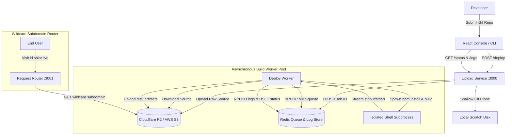

# Shipr

> **A high-throughput, asynchronous Git-to-Cloud frontend deployment engine and wildcard edge router.**

Shipr is a self-hosted, distributed platform designed to automate the lifecycle of frontend web applications (similar to Vercel and Netlify). It features an interactive developer operator console with a live Stageshow pipeline preview, an Express ingestion service with shallow Git cloning, an asynchronous Redis queue-driven build worker pool, and a wildcard subdomain request router streaming compiled static assets directly from S3-compatible object storage.

---

## Architecture Overview



---

## Key Modules & Technical Highlights

- **Asynchronous Decoupled Worker Pool**: The upload/ingestion API is fully decoupled from the build worker via a Redis blocking queue (`BRPOP build-queue 0`). This allows horizontal scaling of stateless build workers across multiple machines without race conditions or job contention.
- **Real-Time Log Streaming with Memory Protection**: Subprocess `stdout` and `stderr` streams during `npm install` and `npm run build` are split by line and appended directly to Redis lists (`logs:<id>`). To prevent unbounded memory consumption, logs are configured with an automated 1-hour expiration TTL (`EXPIRE logs:<id> 3600`).
- **Dynamic Framework & Static Site Detection**: The build worker inspects the downloaded source tree. If `package.json` is detected, it runs the standard dependency installation and compilation pipeline (`dist/`). If no package file exists, it automatically adapts and deploys raw static HTML/CSS/JS files directly.
- **Wildcard Subdomain Reverse Proxy**: Incoming requests extract the tenant/deployment identifier directly from the Host header (`req.hostname.split('.')[0]`), lookup compiled artifacts in object storage with zero local file persistence, and stream the buffers with correct MIME-type negotiation.
- **Interactive Stageshow Visualizer**: The frontend operator console includes an interactive Stageshow demo showcasing each phase of the deployment pipeline in real-time.

---

## Tech Stack

| Layer | Service / Directory | Technologies & Packages |
|---|---|---|
| **Frontend Console** | `frontend/` | React 19, Vite, Tailwind CSS v4, Motion, Lucide, Stageshow UI |
| **API & Upload Service** | `uploadService/` | Node.js, Express, TypeScript, Simple-Git, Redis Client, AWS SDK |
| **Build Worker Pool** | `deployService/` | Node.js, Child Process (`spawn`), TypeScript, Redis Client, AWS SDK |
| **Request Router** | `reqHandler/` | Node.js, Express, TypeScript, AWS SDK (S3 Streaming) |
| **Message Broker & Cache** | External Service | Redis 7+ (`LPUSH`, `BRPOP`, `HSET`, `LRANGE`, `EXPIRE`) |
| **Object Storage** | Cloud Storage | Cloudflare R2 / AWS S3 (S3 API compatible) |

---

## Directory Structure

```text
shipr/
├── uploadService/              # Ingestion API server (Port 3000)
│   ├── src/
│   │   ├── aws.ts              # S3 / Cloudflare R2 source file uploader
│   │   ├── file.ts             # Recursive directory traversal utility
│   │   ├── utils.ts            # Unique deployment ID generator
│   │   └── index.ts            # Express server (POST /deploy, GET /status, /logs)
│   ├── .env.example
│   ├── package.json
│   └── tsconfig.json
├── deployService/              # Asynchronous build worker pool
│   ├── src/
│   │   ├── aws.ts              # S3 source downloader & dist artifact publisher
│   │   ├── utils.ts            # Subprocess build runner (npm install & build)
│   │   └── index.ts            # Worker daemon consuming from Redis queue
│   ├── .env.example
│   ├── package.json
│   └── tsconfig.json
├── reqHandler/                 # Wildcard subdomain edge proxy router (Port 3001)
│   ├── src/
│   │   └── index.ts            # Hostname extractor and S3 buffer streaming proxy
│   ├── .env.example
│   ├── package.json
│   └── tsconfig.json
├── frontend/                   # React 19 developer console & marketing UI
│   ├── src/
│   │   ├── components/
│   │   │   ├── landing/        # Hero, Features, Architecture, FAQ, Comparison
│   │   │   ├── ShiprStageShow.tsx # Stageshow interactive pipeline visualizer
│   │   │   └── landing.tsx     # Live deploy console & log terminal
│   │   ├── stageshow/          # Stageshow UI kit (Window, Stage, Motion, Controls)
│   │   ├── App.tsx
│   │   └── main.tsx
│   ├── .env.example
│   ├── package.json
│   └── vite.config.ts
└── README.md
```

---

## REST API Reference

### Upload Service (Port 3000)

| Method | Endpoint | Description | Request Body / Query | Response Schema | Auth |
|---|---|---|---|---|---|
| `POST` | `/deploy` | Clones repository, uploads raw source to storage, and queues build job | `{"repoUrl": "https://github.com/user/repo"}` | `{"id": "a8f10e", "message": "Deployment enqueued with id: a8f10e"}` | Public |
| `GET` | `/status` | Fetches the current deployment phase from Redis hash | `?id=<deployment_id>` | `{"status": "uploaded" \| "deployed" \| "failed"}` | Public |
| `GET` | `/logs` | Streams real-time build logs captured from subprocess stdout/stderr | `?id=<deployment_id>` | `{"logs": ["✦ Starting build pipeline...", "[install] ..."]}` | Public |
| `GET` | `/health` | Health-check endpoint verifying service status | None | `{"status": "ok", "service": "shipr-upload-service"}` | Public |

### Request Router (Port 3001)

| Method | Endpoint | Description | Host Header / Query | Response |
|---|---|---|---|---|
| `GET` | `/*` | Fetches and streams compiled static assets matching the wildcard subdomain | Host: `<id>.shipr.live` or `?id=<id>` | Raw static file buffer (`text/html`, `application/javascript`, `text/css`, etc.) |

---

## Local Development & Setup

### Prerequisites

- **Node.js**: v20+ (`node -v`)
- **Docker**: For local Redis instance (`docker run`)
- **Cloudflare R2 or AWS S3**: An S3-compatible bucket (e.g. `shipr-deployments`)

---

### Step 1: Start Redis Instance

Run a local Redis container for job queuing and log caching:

```bash
docker run -d --name shipr-redis -p 6379:6379 redis:7-alpine
```

Verify connection:
```bash
docker exec -it shipr-redis redis-cli ping
# Expected response: PONG
```

---

### Step 2: Configure Environment Variables

Create `.env` files in `uploadService/`, `deployService/`, and `reqHandler/`:

```env
ACCESS=your_access_key_id
SECRET=your_secret_access_key
ENDPOINT=https://your-account-id.r2.cloudflarestorage.com
BUCKET=shipr-deployments
REDIS_URL=redis://127.0.0.1:6379
PORT=3000
```

*(For `reqHandler`, set `PORT=3001`).*

Optionally create `frontend/.env`:
```env
VITE_BACKEND_UPLOAD_URL=http://localhost:3000
VITE_ROUTER_URL=http://localhost:3001
```

---

### Step 3: Install & Build All Services

```bash
# Build Upload Service
cd uploadService && npm install && npm run build && cd ..

# Build Worker Pool
cd deployService && npm install && npm run build && cd ..

# Build Request Router
cd reqHandler && npm install && npm run build && cd ..

# Build Frontend
cd frontend && npm install && npm run build && cd ..
```

---

### Step 4: Run Services

In separate terminal sessions:

```bash
# Terminal 1: Ingestion API
cd uploadService && npm start
# Listening on http://localhost:3000

# Terminal 2: Build Worker Pool
cd deployService && npm start
# Active consumer on 'build-queue'

# Terminal 3: Request Router
cd reqHandler && npm start
# Listening on http://localhost:3001

# Terminal 4: Frontend Console
cd frontend && npm run dev
# Dev server on http://localhost:5173
```

Visit `http://localhost:5173` to test live deployments.

---

## Author

**Pankaj Raikar**
- **GitHub**: [@pankaj-raikar](https://github.com/pankaj-raikar)
- **Email**: [pankajraikar6@gmail.com](mailto:pankajraikar6@gmail.com)

---

## License

This project is licensed under the [MIT License](LICENSE).
